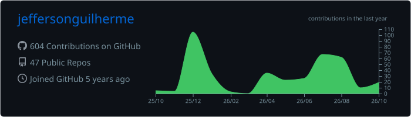
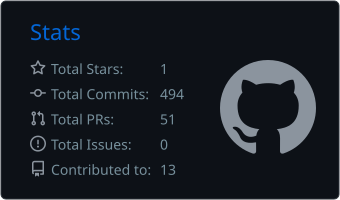
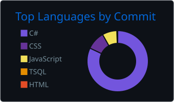

<h1 align="center">Olá, eu sou o Jefferson Guilherme 👋</h1>
<h3 align="center">Desenvolvedor Back-End C# / .NET</h3>

  
  
  

---

## 🧑‍💻 Sobre mim

Sou formado em **Análise e Desenvolvimento de Sistemas** e foco em **desenvolvimento back-end com C# e .NET**. Gosto de construir APIs bem estruturadas, aplicando **Clean Architecture**, **DDD**, **CQRS** e **SOLID**, com atenção a regras de negócio, validação e segurança.

- 🔭 Hoje estou evoluindo meus projetos de portfólio com **testes automatizados**, **Docker** e **CI/CD**
- 🌱 Estudando a fundo: **testes com xUnit**, **Docker**, **GitHub Actions** e **autenticação/autorização**
- 🎯 Buscando minha oportunidade como **Desenvolvedor Back-End .NET Júnior**
- 📚 Fora do código: fã de **Isaac Asimov**, pode puxar assunto!

---

## 🛠️ Tecnologias

**Back-end**

**Bancos de dados**

**Ferramentas e práticas**

**Arquitetura:** Clean Architecture · DDD · CQRS com MediatR · Repository Pattern · FluentValidation · ASP.NET Identity

---

## 🚀 Projetos em destaque

| Projeto | Descrição | Stack |
|---|---|---|
| [**ControledeDespesas**](https://github.com/jeffersonguilherme/ControledeDespesas) | API de finanças pessoais com cadastro de despesas, categorias e métodos de pagamento, filtros, paginação e autenticação. | .NET 8 · Clean Architecture · Dapper · EF Core · Identity · JWT |
| [**study-clean-architecture-dotnet8-cqrs**](https://github.com/jeffersonguilherme/study-clean-architecture-dotnet8-cqrs) | API de catálogo de produtos com CQRS, pipeline de validação e cadastro de usuários com perfil definido pela matrícula. | .NET 8 · MediatR · FluentValidation · EF Core · Identity · JWT |
| [**TradeStore**](https://github.com/jeffersonguilherme/TradeStore) | Gestão de produtos, categorias, tipos e localizações de estoque, organizada em commands e queries. | .NET 8 · CQRS · MediatR · AutoMapper · FluentValidation · SQL Server |
| [**FlightBooking**](https://github.com/jeffersonguilherme/FlightBooking) | API de venda de passagens aéreas com domínio rico (voos, aeroportos, value objects) e Result Pattern. | .NET 8 · DDD · Clean Architecture · MediatR |
| [**study-custom-authorization-handler-aspnetcore8**](https://github.com/jeffersonguilherme/study-custom-authorization-handler-aspnetcore8) | Autorização customizada no ASP.NET Core: permissões definidas por matrícula através de um `AuthorizationHandler`. | ASP.NET Core 8 · Identity · EF Core · SQLite |

---

## 📊 Estatísticas

  

  
  

